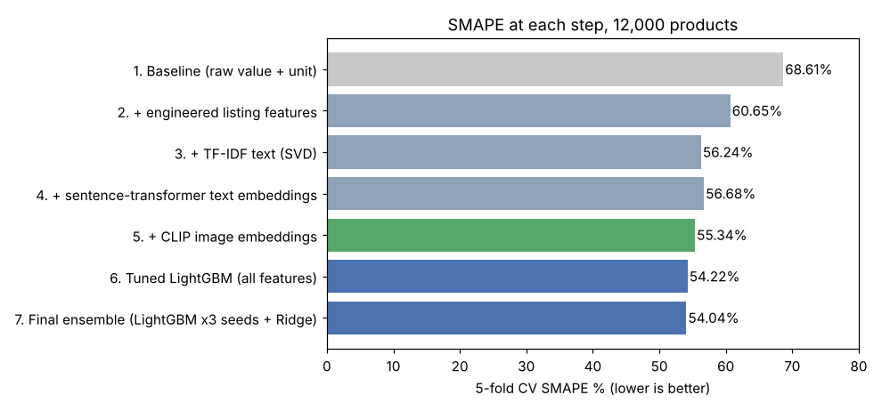
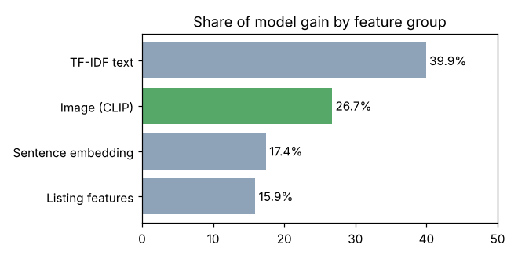

# Product Price Prediction (Amazon ML Challenge 2025)

I built a **multimodal ML pipeline** that predicts a product's price from its catalog text (title, bullet points, quantity, pack size) and its **product image**. I worked on this problem statement in the **Amazon ML Challenge 2025**, where I ranked in the **top 200 of 13,500+ teams**.

## Dataset

`dataset/train.csv.gz`: 75,000 products with `catalog_content` (text), `image_link` and `price`. Amazon shared it with participants of the Amazon ML Challenge 2025, and I uploaded it manually to this repo.

For the experiments below I used a random sample of **12,000 products** (10K+), after validation: no missing values, no duplicate listings, all prices > 0. Prices are heavily skewed (median about $14, max $2,796), so models are trained on log(1 + price).

**Metric:** SMAPE (Symmetric Mean Absolute Percentage Error, 0 to 200%, lower is better)

## Pipeline

1. **Data validation.** I checked for missing values, duplicate listings and invalid prices, then log-transformed the price.
2. **Feature engineering from raw listings.** I extracted quantity value and unit (converted to ounces), pack size, value per pack, brand frequency, text length, number of bullet points and premium keywords.
3. **Text features.** I used TF-IDF (word 1-2 grams) reduced with SVD, plus `all-MiniLM-L6-v2` sentence-transformer embeddings.
4. **Image features.** I downloaded all 12,000 product images and encoded them with **CLIP ViT-B/32**, then reduced the embeddings with PCA.
5. **Models.** I used LightGBM with K-fold tuning, then a final **ensemble of LightGBM (3 seeds) + Ridge on TF-IDF**, with the blend weight chosen by nested CV.

TF-IDF, SVD and PCA are all fit **inside each fold** on training rows only, so there is no leakage.

## Competition result (Amazon ML Challenge 2025)

| | |
|---|---|
| Final SMAPE on Amazon's **hidden test set** (official leaderboard) | **51.20%** |
| Rank | **Top 200 of 13,500+ teams** |

The leaderboard score was calculated by Amazon on test products whose prices were never shared with participants. The numbers below are my own 5-fold cross-validation on a 12,000-product sample of the training data, rebuilt after the challenge. That's why they differ from the leaderboard score.

## Results (5-fold cross-validation, 12,000 products)

| Step | CV SMAPE |
|---|---|
| 1. Baseline (raw quantity value + unit) | 68.61% |
| 2. + engineered listing features | 60.65% |
| 3. + TF-IDF text | 56.24% |
| 4. + sentence-transformer embeddings | 56.68% |
| 5. + **CLIP image embeddings** | 55.34% |
| 6. Tuned LightGBM (all features) | 54.22% |
| **7. Final ensemble (LightGBM × 3 seeds + Ridge)** | **54.04%** |

That's **68.61% → 54.04%**, a **21.2% relative improvement** over the baseline.



**What drives the predictions.** Text carries the most signal, and **images add 26.7%** of the model's gain. Among listing features, quantity in ounces and value per pack matter most.



Full numbers: `reports/cv_results.json`. The notebook was run on Kaggle (GPU T4 x2, about 54 minutes).

## Project structure

```
product-price-prediction/
├── dataset/train.csv.gz                       # Amazon ML Challenge 2025 training data
├── notebooks/product_price_prediction.ipynb   # full pipeline
├── reports/cv_results.json                    # results of the Kaggle run
└── figures/
```

## How to run

On Kaggle (recommended), import `notebooks/product_price_prediction.ipynb`, turn on **GPU** and **Internet**, and click Run All. The notebook downloads the dataset from this repo and the product images itself.

## Tools

Python, Pandas, NumPy, Scikit-learn, LightGBM, Sentence-Transformers, CLIP (Hugging Face Transformers), PyTorch, Matplotlib
